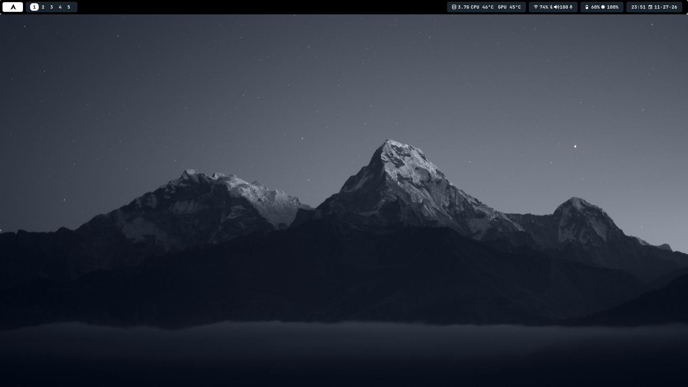
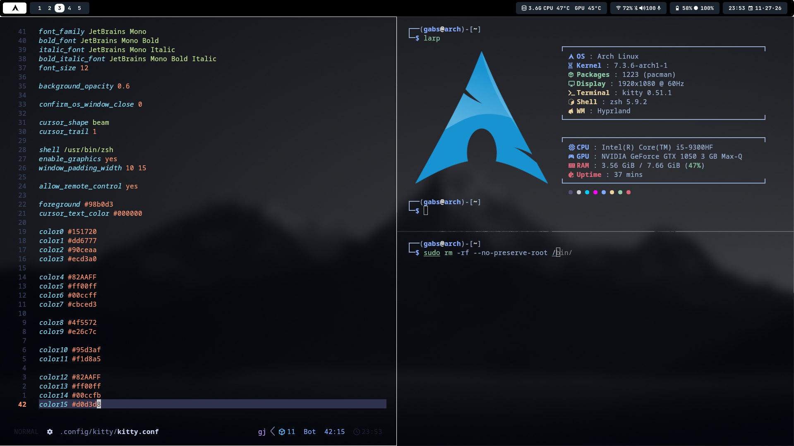

# gabs-hyprdots

Personal Arch Linux setup built around Hyprland (Lua config), Waybar, Dunst,
Rofi, Kitty/Alacritty, and LazyVim.

## Preview

| Desktop | Terminal |
| --- | --- |
|  |  |

## Included

| Area | Files |
| --- | --- |
| Hyprland | `hypr/*.lua`, `hyprlock.conf`, `wallpaper-restart.sh`, `scripts/` |
| Status bar | `waybar/config.jsonc`, `style.css`, `restart.sh`, `scripts/` |
| Notifications | `dunst/dunstrc`, `scripts/playNotificationSound.sh` |
| Launcher | `rofi/config.rasi`, `colors.rasi`, `fonts.rasi` |
| Terminals | `kitty/kitty.conf`, `alacritty/alacritty.toml`, `alacritty/themes/` |
| Editor | `nvim/` (LazyVim, lockfile included) |
| Shell | `.bashrc`, `.bash_profile`, `.inputrc`, `.editrc`, `.blerc` |
| Assets | `assets/wallpapers/`, `assets/screenshots/` |
| Other | `btop`, `clangd`, `clang-format`, `gtk-3.0`, `gtk-4.0`, `gh`, `opencode`, `Code/User`, `hyfetch`, `pavucontrol`, `user-dirs`, `flameshot` |

## Requirements

- Arch Linux (or an Arch-based distribution)
- Hyprland 0.57 or newer (Lua configuration support)
- A Nerd Font: `ttf-jetbrains-mono-nerd`
- `otf-font-awesome` for a few Waybar icons
- An NVIDIA GPU for the `LIBVA_DRIVER_NAME` settings in `hypr/env.lua`

The package lists are in `packages/pacman.txt` and `packages/aur.txt`.

## Install

```sh
cd ~/Dotfiles/gabs-hyprdots
./install.sh
```

Useful options:

| Option | Effect |
| --- | --- |
| `--packages` | Install official packages with `pacman` and AUR packages with `yay` |
| `--reload` | Reload Hyprland, Waybar and Dunst after installing |
| `--force` | Replace an existing `~/.gitconfig` (the default is to skip it) |
| `--dry-run` | Print actions without changing files |
| `--help` | Show the built-in help |

The installer:

1. Backs up every replaced file under
   `${XDG_STATE_HOME:-$HOME/.local/state}/dotfiles-backups/<timestamp>/`.
2. Copies files from `assets/home/` to `$HOME/`, preserving permissions.
3. Replaces `@HOME@` with the real home directory where needed
   (`flameshot.ini`).
4. Creates `~/.config/hypr/wallpapers/` and copies any images from
   `assets/wallpapers/`.
5. Enables the `hyprpolkitagent` user service when available.
6. Leaves `~/.gitconfig` untouched unless `--force` is used.

## Post-install

### Git identity

```sh
$EDITOR ~/.gitconfig        # set user.name and user.email
gh auth login               # credentials are delegated to gh
```

### Wallpaper

The bundled images are installed automatically:

```sh
~/.config/hypr/wallpaper-restart.sh
```

To add another image:

```sh
cp /path/to/image.jpg ~/.config/hypr/wallpapers/
~/.config/hypr/wallpaper-restart.sh
```

Without an image, the script falls back to a solid `#0f161e` background.
`hyprlock.conf` references `wallpapers/joy_division.jpg`, which is included.

Set `WALLPAPER_MODE` to `fit`, `stretch`, `center`, `tile`, or `solid_color`
to override the default `fill` mode.

### Hyprspace overview (optional)

```sh
hyprpm add https://github.com/KZDKM/Hyprspace
hyprpm enable Hyprspace
```

The `SUPER + Tab` bind is guarded, so it does nothing when the plugin is not
loaded.

### Hardware-specific settings

- `hypr/monitors.lua`: output is `eDP-1`. Change it if your panel has another
  name.
- `hypr/input.lua`: keyboard layout is `br`.
- `hypr/env.lua`: NVIDIA VA-API/GLX variables. Remove both lines on systems
  without an NVIDIA GPU.
- `hypr/autostart.lua`: locks immediately after greetd autologin. Remove the
  `hyprlock` line if your display manager already asks for a password.
- `waybar/config.jsonc`: the temperature module reads Intel `coretemp`; the
  GPU module uses `nvidia-smi`. Adjust or remove either module on other
  hardware.

### Lid switch

Closing the lid runs `hypr/scripts/lid.sh`, which starts `hyprlock`, waits for
it to map, and then suspends. If `hyprlock` cannot start, the script refuses to
suspend instead of leaving the session unlocked.

Useful checks:

```sh
hyprctl devices | grep -A1 Switches
hyprctl binds | grep -A8 'Lid Switch'
```

## Structure

```text
gabs-hyprdots/
├── install.sh
├── packages/
│   ├── pacman.txt
│   └── aur.txt
└── assets/
    ├── screenshots/      
    ├── wallpapers/       
    └── home/
        ├── .bashrc
        ├── .gitconfig
        └── .config/
            ├── hypr/
            ├── waybar/
            ├── dunst/
            ├── rofi/
            ├── kitty/
            ├── alacritty/
            ├── nvim/
            └── ...
```

## Keybindings

`SUPER` is the main modifier.

| Keys | Action |
| --- | --- |
| `SUPER + Return` | Kitty |
| `SUPER + B` | Firefox |
| `SUPER + E` | PCManFM |
| `SUPER + D` | Rofi application launcher |
| `SUPER + Tab` | Hyprspace overview (if loaded) |
| `SUPER + Q/W/C` | Close window |
| `SUPER + T` | Toggle floating |
| `SUPER + F` | Toggle maximize |
| `SUPER + Shift + F` | Toggle fullscreen |
| `SUPER + h/j/k/l` | Focus left/down/up/right |
| `SUPER + Shift + h/j/k/l` | Move window |
| `SUPER + arrows` | Resize window |
| `SUPER + 1..0` | Switch workspace |
| `SUPER + Shift + 1..0` | Move window to workspace |
| `SUPER + Shift + S` | Area screenshot to clipboard |
| `Shift + Print` | Area screenshot to clipboard |
| `Print` | Flameshot |
| `SUPER + Shift + C` | Color picker |
| `SUPER + Shift + E` | Logout menu (`wlogout`) |
| `SUPER + P` | Cycle wallpaper |
| `SUPER + Escape` | Lock |
| `SUPER + mouse drag` | Move window |
| `SUPER + right mouse drag` | Resize window |
| `Alt + Tab` | Cycle windows |
| Media keys | Volume, brightness, player control |
| Lid close | Lock and suspend |

## Useful commands

```sh
hyprctl reload
hyprctl configerrors
~/.config/waybar/restart.sh
~/.config/waybar/restart.sh --reload
~/.config/hypr/wallpaper-restart.sh
~/.config/hypr/scripts/screensharing.sh
```

## Privacy and secrets

This tree contains configuration, selected wallpapers, and demo screenshots.
The following items were deliberately excluded:

- `~/.config/gh/hosts.yml` and OAuth tokens
- `~/.config/opencode/service.json` (local service password)
- `~/.git-credentials`, `~/token.txt`, `~/github-recovery-codes.txt`
- Spotify `prefs` (saved credentials)
- Browser profiles, VS Code `globalStorage`, OBS scenes, GIMP/LibreOffice/
  Pinta state, SWI-Prolog history
- Telemetry IDs from `nextjs-nodejs/config.json`
- Personal absolute paths from `QtProject.conf`, GIMP `theme.css`, and
  similar application state

The username and local IP are redacted in
`assets/screenshots/screenshot2.png`.

`~/.gitconfig` uses placeholders and delegates GitHub authentication to `gh`.
The root `.gitignore` keeps generated credentials and local application state
out of version control.

## Not included

- `waybar-2/`: older alternative Waybar configuration. The active one is
  `waybar/`.
- `2026-10-30_10-45.png`: screenshot, not a wallpaper, so it is not bundled.
- `neofetch/config.conf`: `neofetch` is not installed and the file is the
  upstream default.
- Dunst Eww/album-art scripts: Eww is not installed and the scripts were
  unused.
- `hypr/scripts/appLaunch/`: third-party Rofi themes that are not referenced
  by the active Rofi config.
- Bundled `hyprpicker` binary: install the `hyprpicker` package instead.

## Troubleshooting

### Hyprland reports config errors

```sh
hyprctl configerrors
```

`hyprctl reload` applies the Lua config without restarting the session.

### Waybar icons or text are missing

Install `ttf-jetbrains-mono-nerd`, `otf-font-awesome`, `noto-fonts`, and
`noto-fonts-emoji`, then restart Waybar:

```sh
~/.config/waybar/restart.sh
```

### Screen sharing does not work

Restart the portals:

```sh
~/.config/hypr/scripts/screensharing.sh
```

### Temperature shows nothing

The Waybar module expects Intel `coretemp`. Check the path:

```sh
for h in /sys/class/hwmon/hwmon*; do echo "$h: $(cat "$h/name")"; done
```

Then update `hwmon-path-abs` in `waybar/config.jsonc`.

### Spotify module is empty

The module uses `waybar/scripts/spotify.sh` and `playerctl`:

```sh
playerctl -p spotify status
~/.config/waybar/scripts/spotify.sh
```

The script prints an empty text when Spotify is not running.

### Suspend does not happen when closing the lid

Check that Hyprland sees the switch and the bind:

```sh
hyprctl devices | grep -A1 Switches
hyprctl binds | grep -A8 'Lid Switch'
```

Run the script manually to see the error:

```sh
~/.config/hypr/scripts/lid.sh
```

## Restore a backup

```sh
ls ~/.local/state/dotfiles-backups/
cp -a ~/.local/state/dotfiles-backups/<timestamp>/. ~/
```

## Credits

- Rofi themes based on Aditya Shakya's (`adi1090x`) themes.
- Neovim configuration based on [LazyVim](https://github.com/LazyVim/LazyVim);
  its license is kept in `nvim/LICENSE`.
- Hyprspace plugin by [KZDKM](https://github.com/KZDKM/Hyprspace).
